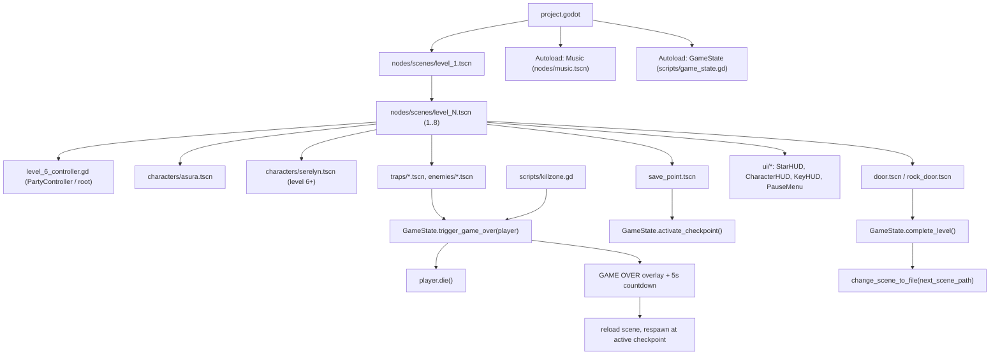

# Dungeon Traps - Project Architecture

Updated: 2026-11-13

This document describes the actual architecture and runtime behavior of the project.

## Core Principles

- Level scenes only hold placement, never logic.
- Trap/door/torch/player are self-contained reusable scenes that only know their own behavior.
- `GameState` is the single autoload that owns the death flow and restart.
- Every hazard goes through the same entry point: `GameState.trigger_game_over(body)`.
- Per-level configuration is passed via `@export`, never hard-coded in scripts.

## Runtime Diagram



## Layers Of Responsibility

### Project Config

`project.godot` defines the main scene, input map, autoloads, global groups and render defaults. It holds no gameplay logic.

- Main scene: `nodes/scenes/level_1.tscn` (referenced by UID `uid://l1dhtqji1d6x`).
- Autoload `Music`: scene `nodes/music.tscn`, an `AudioStreamPlayer` autoplaying `background_music.mp3` globally on the `Music` bus.
- Autoload `GameState`: `scripts/game_state.gd`.
- Global group: `player`.
- Input actions: `move_left` (←), `move_right` (D/→), `jump` (X), `attack` (C), `slide` (Z), `interact` (E), `switch_character` (A, level 6+).

`default_bus_layout.tres` defines the `Music` bus (-6 dB) and the `SFX` bus (0 dB), both routed to `Master`.

### Level Scenes

`nodes/scenes/level_1.tscn` … `nodes/scenes/level_8.tscn` (root `Level1` … `Level8`).

A level contains:

- The player instance, with its camera and `PointLight2D` parented under it.
- TileMap/background.
- Trap, door and torch instances, grouped under plain `Node` list holders: `FireList`, `ThornList`, `BowTrapList`, `PendulumList`, `TorchList`, `SlimeList`, `BatList`, `StarList`, `ChestList`. Các holder này không phải `Node2D` nên không có transform, đưa instance vào list không làm đổi vị trí. (`DecorList` của `level_6` là `Node2D`.)
- Save point (`save_point.tscn`) ở level 3–8.
- HUD instances: `StarHUD`, `PauseMenu`, `CharacterHUD` (level 6+ đặt sẵn; màn khác do controller tạo khi đã có Serelyn), `KeyHUD` (chỉ `level_6`).
- Instance-specific configuration such as `Door.next_scene_path`.

Levels hold no death/restart logic, no character movement logic, and no global state.

Controller của màn:

| Màn | Script | Gắn ở |
| --- | --- | --- |
| `level_1` … `level_5` | `scripts/level_6_controller.gd` | Node con `PartyController` |
| `level_6` … `level_8` | `scripts/level_6_controller.gd` | Node gốc |
| `level_4` | `scripts/chest_ambush_controller.gd` | Node gốc (đàn dơi phục kích, xem mục Level 4 Bat Ambush) |

Tên `level_6_controller.gd` là lịch sử: script này giờ là controller đội hình dùng chung cho mọi màn (Serelyn, chuyển nhân vật, camera, `CharacterHUD`). Nó tự nhận ra mình gắn ở gốc hay ở node con qua việc có tìm thấy `Asura` cạnh mình hay không.

### Reusable Gameplay Scenes

| Scene | Owning logic |
| --- | --- |
| `characters/asura.tscn` | `scripts/actors/asura_controller.gd` |
| `characters/serelyn.tscn` | `scripts/actors/serelyn_controller.gd` |
| `traps/fire_trap.tscn` | `scripts/fire_trap.gd` |
| `traps/thorn.tscn` | `scripts/thorn_trap.gd` |
| `traps/pendulum_trap.tscn` | `scripts/pendulum_trap.gd` |
| `door.tscn` | `scripts/door.gd` (cửa tự mở) |
| `rock_door.tscn` | `scripts/door.gd` (cửa đá, đặt `required_key_id` để cần chìa) |
| `save_point.tscn` | `scripts/save_point.gd` |
| `killzone.tscn` | `scripts/killzone.gd` |
| `torch.tscn` | Animation + `PointLight2D` in the scene, no script |
| `effects/landing_dust.tscn` | `scripts/landing_dust.gd` |
| `effects/skill_reveal.tscn` | `scripts/skill_reveal.gd` (rương tự instantiate) |
| `items/treasure_chest.tscn` | `scripts/treasure_chest.gd` (`@export skill_id` để trao kỹ năng) |
| `ui/skill_popup.tscn` | `scripts/ui/skill_popup.gd` (rương tự instantiate, level không đặt sẵn) |
| `enemies/slime.tscn` | `scripts/slime.gd` (only used by the legacy `game.tscn`) |
| `items/coin.tscn` | `scripts/coin.gd` (only used by the legacy `game.tscn`) |
| `platforms/pushable_wooden_crate.tscn`, `platforms/pushable_steel_crate.tscn` | `scripts/pushable_crate.gd` (`class_name PushableCrate`) |
| `platforms/hanging_steel_crate.tscn` | `scripts/hanging_steel_crate.gd` + `scripts/cuttable_rope.gd` |
| `effects/character_transform_effect.tscn` | `scripts/character_transform_effect.gd` |
| `ui/character_hud.tscn` | `scripts/ui/character_hud.gd` |
| `ui/key_hud.tscn` | `scripts/ui/key_hud.gd` (`class_name KeyHUD`, group `key_hud`) |
| `ui/pause_menu.tscn` | `scripts/ui/pause_menu.gd` |
| `star_hud.tscn` | `scripts/ui/star_hud.gd` |
| `items/crystal_key.tscn` | `scripts/items/crystal_key.gd` (`class_name CrystalKey`) |
| `decor/decor-crystal.tscn`, `decor/decor-big-crystal.tscn` | `scripts/decor_crystal.gd`, `scripts/decor_big_crystal.gd` (`@export key_id`) |
| `enemies/spitter_slime.tscn`, `enemies/spitter_slime_bullet.tscn` | `scripts/spitter_slime.gd`, `scripts/spitter_slime_bullet.gd` |
| `characters/serelyn_arrow.tscn` | `scripts/actors/serelyn_arrow.gd` (`class_name SerelynArrow`) |
| `effects/hit_effect.tscn`, `effects/serelyn_arrow_muzzle.tscn`, `effects/serelyn_arrow_impact.tscn` | `scripts/hit_effect.gd` (chạy animation `hit` một lần rồi tự xoá) |
| `platform.tscn`, `tile_map_32.tscn` | No script |

A reusable scene that needs to change global state calls an autoload or emits a signal; it never changes the scene itself.

### Scripts

Scripts live under `res://scripts/`, with `actors/`, `items/` and `ui/` subgroups; the smaller gameplay scripts are currently flat in `scripts/`.

Files currently not referenced by any level: `scripts/level_1_controller.gd` and `scripts/level_2_controller.gd` (both only `extends Node2D`), and `nodes/traps/gai.tscn` (the old thorn scene, still wired to `fire_trap.gd`, superseded by `traps/thorn.tscn`). `scripts/actors/asura_controller.gd.orig` là bản sao lưu, không được nạp.

`scripts/save_game.gd` không gắn vào scene nào: nó là tiện ích static, chỉ
`GameState` gọi tới — xem mục Save File.

### Assets

`assets/` holds passive data only — textures, sounds, music, fonts. No gameplay scripts.

Hầu hết file trong `assets/sounds/` đã được scene hoặc `preload` dùng tới. Tính theo đường dẫn, các file chưa nơi nào tham chiếu là: `abdalrahman_bm-8-bit-grass-footsteps-2-408574.mp3`, `hurt.wav`, `jump.wav`, `running.mp3`, `serelyn_slide_air.wav`.

Sprite UI kiểu pixel nằm ở `assets/sprites/ui/` và được bọc thành `StyleBoxTexture` trong `nodes/ui/styles/` — xem mục HUD.

Các sprite cũ được giữ lại nhưng không còn scene nào dùng: `assets/sprites/save-flag.png` (thay bằng `save_point.png`), `assets/sprites/enemies/spitter-slime-bullet.png` (thay bằng `spitter_slime_bullet_sheet.png`).

## Main Flows

### Player Characters

Character scenes own their movement, combat, animation and death behavior. The
character-specific details are documented separately: [Asura](characters/asura.md)
and [Serelyn](characters/serelyn.md). Both player characters implement `die()`,
the contract used by `GameState` during the shared game-over flow.

### Game Over

`fire_trap.gd`, `thorn_trap.gd`, `bow_trap.gd`, `pendulum_trap.gd` and `killzone.gd` all share one death flow:

```text
Hazard body_entered
  -> if the body is in the player group
  -> /root/GameState.trigger_game_over(body)
  -> state = GAME_OVER, remember the current scene
  -> play game_over.mp3 (SFX bus)
  -> player.die()
  -> CanvasLayer overlay at layer 100 + 5 second countdown
  -> change_scene_to_file(current scene)
  -> reset_to_playing()
```

`GameState` runs with `PROCESS_MODE_ALWAYS` and restarts the **scene currently being played** (`_get_current_scene_path()`) rather than always level 1; `DEFAULT_RESTART_SCENE_PATH` is only a fallback. Hazards never reload the scene themselves.

### Fire Trap

The fire trap has two areas: `TriggerArea` (mask 2) and the damage area on the root `Area2D` itself (mask 2).

```text
_ready
  -> nếu always_active: tắt TriggerArea, bật luôn sprite + damage shape (không phát AppearSound)
  -> ngược lại: sprite hidden, damage shape disabled
TriggerArea.body_entered (player)
  -> disable the trigger's monitoring
  -> show the sprite, play AppearSound
  -> enable the damage shape and monitoring
body_entered (player) -> GameState.trigger_game_over()
```

`extinguish()` dập tắt bẫy vĩnh viễn: tắt `TriggerArea`, damage shape và monitoring, rồi làm mờ sprite cùng `PointLight2D` trong `EXTINGUISH_DURATION` (0.3s) và ẩn đi. `_activate()` bỏ qua bẫy đã tắt. Hiện chỉ hộp sắt gọi hàm này — xem mục Pushable Crate.

Exported parameter: `always_active` (mặc định `false`). Bật lên thì bẫy cháy sẵn từ đầu màn — dùng cho dàn lửa đặt làm chướng ngại nhìn thấy trước chứ không phải bẫy bất ngờ. Trường hợp này `AppearSound` bị bỏ qua, vì cả dàn sẽ kêu cùng lúc lúc vào màn. `level_4` đặt `always_active = true` cho `FireList/Fire2..Fire31` (dải lửa ở `y = -936`); riêng `FireList/Fire` vẫn là bẫy nấp chờ.

### Pushable Crate

Hai scene hộp 32x32 dùng chung `scripts/pushable_crate.gd`, gốc là `CharacterBody2D` đặt tâm ở giữa hộp (đặt vào lưới 32px thì toạ độ là tâm ô):

| Scene | `push_speed` | `breakable` | `FireSensor` |
| --- | --- | --- | --- |
| `platforms/pushable_wooden_crate.tscn` | 120 | `true` | Không |
| `platforms/pushable_steel_crate.tscn` | 100 | `false` | Có |

Hộp nằm trên layer 1 (world), mask 1, nên nhân vật đứng lên nóc như mặt đất và slime/đạn coi nó là tường. Hộp có trọng lực, đẩy ra khỏi mép thì rơi.

```text
asura_controller.gd hoặc serelyn_controller.gd, nhánh di chuyển thường, sau move_and_slide()
  -> nếu is_on_floor() và có bấm hướng: PushableCrate.push_touching(self, direction)
push_touching: duyệt slide collision, collider là PushableCrate
  -> bỏ qua nếu normal.x * direction > -PUSH_NORMAL_MIN (0.7): không phải mặt bên phía trước
  -> crate.push(direction)   # hộp đang rơi thì bỏ qua
PushableCrate._physics_process
  -> velocity.x = hướng bị đẩy ở bước vừa rồi * push_speed, rồi reset về 0
  -> move_and_slide(); nếu đang bị đẩy thì push_touching(self, ...) để hộp đẩy hộp
```

Hộp chỉ trượt trong bước physics được đẩy, nên buông phím là dừng ngay. Nhảy vào hộp giữa không trung, lướt (slide) hay đang chém đều không đẩy. Đứng trên nóc hộp không đẩy được chính nó nhờ ngưỡng `PUSH_NORMAL_MIN`.

**Hộp gỗ vỡ khi bị chém hoặc bị tên bắn trúng.** `breakable = true` làm `_ready()` bật thêm layer 3 (lớp mà `AttackHitbox` và mũi tên của Serelyn quét) và thêm hộp vào group `breakable`. `hit_enemy()` của Asura gọi `break_apart()` cho group này thay vì `die()`; `SerelynArrow` cũng gọi cùng hàm khi ray trúng group `breakable`: tắt va chạm ngay (người đứng trên nóc rơi xuống luôn), phát tiếng poof trên một `AudioStreamPlayer2D` gắn vào `current_scene`, cắt ảnh hộp thành bốn góc văng theo cung parabol rồi `queue_free()`. Hộp sắt không có layer 3 nên đòn chém đi xuyên qua, nhưng vẫn chặn mũi tên như vật cản layer 1.

**Hộp sắt dập lửa.** `FireSensor` (Area2D, layer 0, mask 1, shape 20x30) nối `area_entered`; area nào có `extinguish()` thì gọi. Sensor hẹp hơn thân hộp để lửa chỉ tắt khi hộp đã phủ lên ngọn lửa. Bẫy lửa nấp chờ chưa bật damage shape thì sensor chưa thấy, nên hộp đặt sẵn trên bẫy nấp chờ sẽ dập lửa ngay khi bẫy bùng lên. Hộp gỗ không có sensor, đi qua lửa không có tác dụng gì.

Hạn chế đã biết: hộp chồng lên hộp không trượt theo khi hộp dưới bị đẩy (`CharacterBody2D` không báo vận tốc nền cho vật đứng trên), hộp trên sẽ rớt khỏi mép.

### Thorn Trap

`traps/thorn.tscn` is a `Node2D` containing `Hazard` (an Area2D) and `TriggerArea`.

```text
_ready: physics process disabled
TriggerArea.body_entered (player) -> _is_falling = true, enable physics process
_physics_process: raycast downward from 3 points (-half_width, 0, +half_width)
  -> on hitting the floor, snap to the floor surface and stop
  -> or stop after falling past max_fall_distance
Hazard.body_entered (player) -> GameState.trigger_game_over()
```

Exported parameters: `fall_speed`, `max_fall_distance`, `floor_collision_mask`, `thorn_half_width`, `thorn_half_height`, `floor_probe_margin`. The script halts itself when `GameState.is_game_over()`.

### Pendulum Trap

`traps/pendulum_trap.tscn` là quả cầu gai treo bằng xích, đu qua lại liên tục. Gốc node chính là **điểm neo**, nên đặt instance ngay tại mặt trần là con lắc treo đúng chỗ — không phải căn lại sprite con.

```text
_ready -> nối Pivot/Ball.body_entered
_physics_process
  -> nếu GameState.is_game_over() thì dừng, để khung hình chết không còn quả cầu đu
  -> Pivot.rotation = swing_angle * sin(TAU * (t / swing_period + phase_offset))
Ball.body_entered (player) -> GameState.trigger_game_over()
```

Cả cây con lắc là **một `Sprite2D` duy nhất** vẽ trọn `doom-ball.png` (vòng neo, xích và quả cầu), không cắt ảnh ra thành nhiều mảnh. Sprite đặt ở `(0, 80)` để mép trên của ảnh trùng điểm neo, `Ball` đặt ở `(0, 127)` là đúng tâm quả cầu trong ảnh; cả hai đều là con của `Pivot` nên chỉ cần xoay một node là toàn bộ con lắc đu theo. `Ball` là `Area2D` di chuyển trong `_physics_process` nên va chạm vẫn được tính đúng từng frame vật lý.

Exported parameters:

| Tham số | Mặc định | Ý nghĩa |
| --- | --- | --- |
| `swing_angle_degrees` | 55 | Góc lệch tối đa so với phương thẳng đứng, cho mỗi bên |
| `swing_period` | 4.4 | Thời gian một chu kỳ đầy đủ (giữa → phải → giữa → trái → giữa) |
| `phase_offset` | 0.0 | Dịch pha theo tỉ lệ chu kỳ (0..1), để các con lắc cạnh nhau đu so le |

Độ dài con lắc là cố định theo ảnh (157px từ điểm neo tới đáy quả cầu), nên **tầm với chỉnh bằng `scale` của node gốc** chứ không có tham số riêng. Scene để sẵn `scale = 1.5`, chọn theo hành lang cao 256px của `level_4` (trần và sàn cách nhau 8 ô 32px): lúc buông thẳng, đáy quả cầu chỉ cách sàn 20px nên chặn cả người đứng lẫn người lướt; lúc đu tới góc lớn nhất thì cầu nhấc lên đủ cho player chạy qua bên dưới. Đặt ở hành lang cao khác thì lấy `scale = (chiều cao hành lang - 20) / 157`.

Hitbox là `CircleShape2D` bán kính 26 trong khi gai vươn tới 30px, tức là hơi rộng lượng với người chơi. Bán kính này nằm trong node đã bị `scale`, nên phóng to sprite thì hitbox phóng theo.

### Door / Level Transition

`door.gd` uses two Area2Ds and is shared by `door.tscn` and `rock_door.tscn`:

- `OpenArea`: entering it plays the `open` animation (cửa thường).
- `PassArea`: entering it once the door is open changes the scene after a 0.3s delay.

`next_scene_path` is an `@export`, configured per level instance:

| Màn | Cửa | Đi tới |
| --- | --- | --- |
| `level_1` … `level_5` | `door.tscn` | màn kế tiếp (`level_2` … `level_6`) |
| `level_6` | `rock_door.tscn`, `required_key_id = "crystal_key"` | `level_7` |
| `level_7` | `door.tscn` | `level_8` |
| `level_8` | `door.tscn` | (trống: màn cuối) |

An empty `next_scene_path` means the door does not change scenes.

Qua được `PassArea` lúc cửa đã mở cũng là lúc màn được tính là hoàn thành:
`_go_to_next_scene()` gọi `GameState.complete_level()` **trước** khi đổi scene, vì
`GameState` nhận diện màn qua `_get_current_scene_path()` và đường dẫn đó chỉ còn
đúng ở thời điểm này. Cửa cuối chưa trỏ đi đâu vẫn tính là hoàn thành rồi mới dừng.

**Cửa cần chìa** (`required_key_id` khác rỗng) chạy theo luồng khác:

```text
OpenArea.body_entered (player) -> chỉ nhớ người chơi, KHÔNG tự mở
_process -> hiện chữ "C" nhấp nhô trên cửa nếu người chơi đứng gần và GameState.has_key()
_unhandled_input (attack = C)
  -> set_input_as_handled() để nhân vật không vung kiếm / bắn tên
  -> add_to_group("cutscene_lock"), player.set_controlled(false)
  -> KeyHUD.release_key(); CrystalKey bay từ ô HUD vào ổ khoá (key_slot_offset)
  -> GameState.use_key(), tiếng "tap", cửa loé sáng
  -> play("open") + tiếng move_boulder (tắt loop trên bản sao stream)
  -> hết animation: trả điều khiển, bỏ khỏi cutscene_lock
_process (cửa đã mở)
  -> chỉ chuyển màn khi người chơi ở PassArea, đang di chuyển (|velocity.x| > 1)
     và cách tâm cửa <= DOOR_CENTER_TOLERANCE (6px)
```

Đứng yên sẵn giữa cửa lúc cửa mở xong thì chưa chuyển màn; phải đi hoặc lướt. Hồi sinh sau khi đã tra chìa thì `_ready()` dựng cửa ở khung mở cuối cùng. `level_6_controller.gd` không cho đổi nhân vật (A) khi group `cutscene_lock` còn node.

### Skills

Kỹ năng mở khoá được khai báo một chỗ duy nhất trong `scripts/skills.gd` (`class_name Skills`): tên hiển thị, mô tả, phím tắt và ô icon trong dải `assets/sprites/skills/skills.png` (mỗi ô 32x32, `icon_index` tính từ 0).

`GameState` giữ kỹ năng ở **hai** danh sách tách bạch:

| Danh sách | Nội dung | Mất khi tắt game? |
| --- | --- | --- |
| `_unlocked_skills` | `skill_id -> scene_path`, kỹ năng vừa nhặt nhưng chưa đi hết màn | Có |
| `_saved_skills` | `skill_id -> true`, kỹ năng đã hoàn thành màn và ghi ra file | Không |

`has_skill()` trả về true nếu kỹ năng nằm ở một trong hai, nên nhặt xong là dùng
được ngay trong màn đó chứ không phải đợi qua cửa. `clear_level_progress(scene_path)`
chỉ khoá lại được kỹ năng còn nằm ở `_unlocked_skills`, tức là kỹ năng nhặt trong
màn đó mà chưa đi hết màn — chơi lại một màn cũ không làm mất kỹ năng đã kiếm được.

```text
TreasureChest.body_entered (player)
  -> GameState.mark_chest_opened(), phát animation "open"
  -> nếu skill_id rỗng thì dừng ở đây
  -> GameState.unlock_skill(skill_id)   # ghi nhận trước phần trình diễn
  -> await animation_finished (không đóng băng animation mở rương)
  -> effects/skill_reveal.tscn: icon bay lên khỏi nắp rương, nở to, sáng dần
  -> nếu GameState.is_game_over() thì bỏ popup
  -> instantiate ui/skill_popup.tscn vào current_scene, show_skill(skill_id)
  -> popup pause SceneTree, bảng fade + scale vào, đóng bằng Continue/Space/ESC
```

Kỹ năng được `unlock_skill()` ngay lúc rương mở chứ không phải cuối phần trình diễn: rương đã bị đánh dấu là đã mở nên nếu người chơi chết giữa chừng, đợi tới cuối mới ghi nhận là mất luôn kỹ năng. Vì lý do ngược lại, `_show_skill_popup()` bỏ qua popup khi đang game over — popup pause SceneTree, mà sau khi màn được load lại thì không còn node nào gỡ pause ra nữa.

`skill_reveal.tscn` là ngoại lệ của quy ước modulate ở mục Lighting: icon phần thưởng để nguyên độ sáng và tự mang theo `PointLight2D`.

| Skill | Rương trao | Hiệu ứng |
| --- | --- | --- |
| `spin_jump_attack` | `level_3` | Chi tiết hiệu ứng trong [tài liệu Asura](characters/asura.md). |
| `wall_double_jump` | `level_4` | Đang trên không và chạm tường thì nhấn `jump` (mũi tên lên) được nhảy thêm một lần. |

Chi tiết cách từng nhân vật triển khai đòn đánh và kỹ năng nằm trong
[tài liệu Asura](characters/asura.md) và [tài liệu Serelyn](characters/serelyn.md).

Bảng nhân vật trong `pause_menu.tscn` có sẵn hàng `SkillList/SpinJumpAttack` và `SkillList/WallJump` nhưng đều để `visible = false`; `_pause()` bật từng hàng lên theo `GameState.has_skill()`.

### Serelyn Recruitment And Character Switching

`level_6.tscn` đặt Serelyn làm NPC gần điểm xuất phát và chứa `DialogueLayer`.
`scripts/level_6_controller.gd` quản lý việc tuyển thành viên và chuyển nhân
vật bằng A; camera, `PointLight2D` và `ui/character_hud.tscn` theo nhân vật đang
được điều khiển. Level 7 không đặt Serelyn sẵn trong scene; controller chỉ tạo
cô ấy tại vị trí Asura nếu trạng thái lưu cho biết đã kết nạp cô ở level 6.
Chi tiết hội thoại và hành vi của từng nhân vật nằm trong
[tài liệu Serelyn](characters/serelyn.md) và [tài liệu Asura](characters/asura.md).

### Hanging Steel Crate

`level_6.tscn` dùng `platforms/hanging_steel_crate.tscn` cho node
`HangingSteelCrate`.
Gốc scene là điểm neo trên trần; `rope_length` đặt khoảng cách từ neo đến mép
trên của hộp. Dây nằm trên collision layer 4 để raycast của tên nhận được,
phát tín hiệu khi trúng tên; scene cắt dây rồi bỏ trạng thái `suspended` của
hộp sắt, cho hộp rơi và tiếp tục đẩy được sau khi chạm sàn.

### Save File

`scripts/save_game.gd` (`class_name SaveGame`) là toàn bộ phần đọc/ghi đĩa của
game: một file JSON ở `user://save_game.json`, chứa kỹ năng đã kiếm được và
thành viên đã gia nhập đội.

```json
{
	"version": 1,
	"unlocked_skills": ["spin_jump_attack"],
	"party_members": ["serelyn"]
}
```

`version` chưa được dùng để làm gì, nhưng có sẵn để bản game sau còn đọc được
file của bản trước khi cấu trúc đổi. File ghi kèm tab xuống dòng nên mở ra sửa
tay lúc test rất nhanh.

`SaveGame` có các hàm static đọc/ghi kỹ năng và thành viên; khi ghi một danh sách,
nó giữ nguyên danh sách còn lại. `GameState` là node duy nhất gọi tới nó — phần
còn lại của game hỏi `GameState.has_skill()` hoặc `has_party_member()`.

`user://` nằm ngoài thư mục project (trên Linux là
`~/.local/share/godot/app_userdata/<tên project>/`), nên file save không bao giờ
lọt vào repo; `.gitignore` vẫn chặn tên `save_game.json` để phòng trường hợp có
người copy nó vào project để xem. Bản export HTML thì Godot ánh xạ `user://` vào
IndexedDB của trình duyệt, cùng đoạn code chạy được cả hai nơi.

```text
TreasureChest mở  -> GameState.unlock_skill()   # vào _unlocked_skills (tạm)
Door PassArea     -> GameState.complete_level() # chuyển sang _saved_skills + ghi file
Mở game lần sau   -> GameState._ready()         # SaveGame.load_skills() nạp lại
```

Kỹ năng chỉ được ghi ra file khi người chơi **vừa mở rương vừa đi hết màn đó**.
Nhặt xong rồi chết hoặc thoát giữa chừng thì phần thưởng không được tính, nhưng
vẫn dùng được cho tới hết phiên chơi vì `_unlocked_skills` còn giữ.

`complete_level()` chỉ ghi đĩa khi thật sự có kỹ năng mới, nên đi qua cửa ở màn
không có rương không tốn một lần ghi file nào.

Chống hỏng dữ liệu: mọi lỗi đọc/ghi chỉ `push_warning`/`push_error` rồi đi tiếp,
chưa có file được coi là bình thường (lần chơi đầu), và `load_skills()` bỏ qua id
không còn trong `Skills.CATALOG` — xoá một kỹ năng khỏi catalog không làm file
save cũ dựng game lên.

`clear_level_progress()` gọi với `scene_path` rỗng là lệnh xoá sạch, kể cả file
save; gọi với một màn cụ thể (nút Restart và màn hình chọn màn đang dùng) thì
không đụng tới file.

### Save Point / Checkpoint

`save_point.tscn` (`Area2D`, layer 0, mask 2) là điểm hồi sinh trong màn, dùng ở level 3–8.

```text
body_entered (player)
  -> GameState.activate_checkpoint(global_position + spawn_offset)
  -> cờ phấp phới một lần (khung 1..3) rồi đứng yên ở khung 4
  -> Glow loé lên GLOW_BURST_ENERGY rồi dịu về GLOW_ENERGY, Sparks bắn tia lửa
_ready: GameState.is_checkpoint_active() -> khung 4 + đèn sáng sẵn, không loé lại
```

`assets/sprites/save_point.png` là sprite sheet 5 khung 64x64: khung 0 chưa kích hoạt (cờ màu trầm, ngọc tắt), khung 1–3 phấp phới dịu dần, khung 4 đã kích hoạt. Cờ dùng bảng màu tóc Asura, chữ thập đỏ đậm viền vàng ở giữa. Save point không còn hạ `modulate`; độ tối của trạng thái chưa kích hoạt nằm sẵn trong màu vẽ.

### Crystal Key (Level 6)

Chìa khoá theo màn được lưu trong `GameState` giống sao và rương: `_level_keys` là `scene_path -> { key_id: KeyState }` với `KeyState.HELD` / `KeyState.USED`, phát signal `keys_changed`. API: `collect_key()`, `use_key()`, `has_key()` (đang cầm), `is_key_collected()`, `is_key_used()`. `clear_level_progress()` xoá cả chìa.

```text
decor-big-crystal (key_id = "crystal_key") bị chém / bắn vỡ
  -> GameState.collect_key()            # ghi nhận ngay, chết giữa chừng vẫn giữ chìa
  -> CrystalKey sinh ở current_scene, trồi lên có hào quang (play_reveal)
  -> hào quang tắt dần trên đường bay về ô KeyHUD (fly_to, đích tính lại mỗi frame)
  -> KeyHUD.receive_key(): ô nảy lên + tiếng power_up
rock_door: xem mục Door
```

- `CrystalKey` tự chạy chuỗi hiệu ứng trên chính nó vì pha lê `queue_free()` ngay sau animation vỡ.
- `glowing = false` tắt hào quang (quầng sáng, tia sáng, hạt, `PointLight2D`). Chìa trên HUD và chìa bay vào cửa đều không phát sáng; chỉ lúc vừa rơi ra mới sáng.
- Toạ độ thế giới ↔ màn hình đổi qua `get_viewport().get_canvas_transform()`; scale được chia cho zoom camera (`world_scale_for_hud()`) để chìa không giật kích thước khi chạm ô HUD.
- Hồi sinh sau khi đã lấy chìa: pha lê có `key_id` tự `queue_free()` trong `_ready()`, `KeyHUD` hiện ô ngay nếu `has_key()`.

### HUD Và Phong Cách Pixel

Góc trái trên: nút menu `PauseMenu/MenuButton` (12,12)–(48,48), ô chìa `KeyHUD/Slot` ngay dưới (12,56)–(48,92), cụm chân dung `CharacterHUD/Portraits` từ x=56. `StarHUD` ở góc phải trên.

Khung UI không dùng `StyleBoxFlat` bo góc nữa mà dùng `StyleBoxTexture` 9-slice vẽ pixel (mỗi pixel nghệ thuật = 2x2 pixel màn hình):

| Resource | Texture | Dùng cho |
| --- | --- | --- |
| `nodes/ui/styles/frame_gold.tres` | `assets/sprites/ui/frame_gold.png` | Nút menu (thường), khung chân dung nhân vật đang điều khiển |
| `nodes/ui/styles/frame_stone.tres` | `frame_stone.png` | Chân dung nhân vật còn lại, ô chìa khoá |
| `nodes/ui/styles/menu_button_hover.tres` / `menu_button_pressed.tres` | `frame_gold_hover.png` / `frame_gold_pressed.png` | Nút menu khi rê chuột / nhấn |
| `nodes/ui/styles/frame_mini_gold.tres` | `frame_mini_gold.png` | Badge đếm giờ đổi nhân vật |
| `nodes/ui/styles/button_focus.tres` | `frame_gold_outline.png` | Nút trong bảng pause khi đang được chọn |

`pause_menu.tscn` dùng cùng texture trong các `StyleBoxTexture` nội bộ (khung bảng, khung chân dung, badge phím). Chân dung chỉ lấy phần đầu nhân vật (Asura `Rect2(16, 0, 32, 32)`, Serelyn `Rect2(32, 32, 32, 32)`, giống `CharacterHUD`) phóng 2x vào ô 64x64. Bảng rộng cố định 440px; mỗi hàng kỹ năng là icon 32x32 không khung (`StyleBox_skill_icon` là `StyleBoxEmpty` lề 4px) + cột chữ gồm dòng `Text/Top` (tên bên trái, badge phím dồn phải) và `Text/Desc` tự xuống dòng. Ba nút nằm trong `VBox/Buttons`, dùng `frame_stone.tres` khi thường, `button_focus.tres` (`frame_gold_outline.png`, viền vàng lõi trong suốt) khi focus, `menu_button_hover/pressed.tres` khi rê chuột / nhấn. Icon menu là `assets/sprites/ui/icon_menu.png`. `CharacterHUD._set_card()` đổi giữa `frame_gold.tres` và `frame_stone.tres` thay vì đổi màu viền.

### Projectile Effects

**Đạn SpitterSlime** (`spitter_slime_bullet.tscn`): sprite sheet `assets/sprites/enemies/spitter_slime_bullet_sheet.png`, hàng trên `fly` 4 khung (giọt độc co giãn, xoay theo `velocity.angle()`), hàng dưới `pop` 5 khung (vỡ toé). Vệt đuôi là `CPUParticles2D` `Trail` (toạ độ thế giới) thay cho vòng tròn vẽ bằng `_draw()`. Đèn `Glow` phập phồng khi bay, tắt dần lúc vỡ. Va chạm, quỹ đạo và khói độc không đổi.

**Mũi tên Serelyn** (`serelyn_arrow.tscn`): giữ nguyên sprite gốc `Serelyn-arrow.png`; hiệu ứng nằm ở node con `Sprite2D/Fx` (`serelyn_arrow_fx.png`, 3 khung: vệt sáng sau đuôi + đốm lấp lánh trước mũi, vẽ phía sau mũi tên). `launch()` sinh `effects/serelyn_arrow_muzzle.tscn` tại điểm bắn; mỗi lần ray trúng bất cứ gì sinh `effects/serelyn_arrow_impact.tscn` (trúng enemy vẫn có thêm `hit_effect.tscn` như cũ). `GreenGlow` ~2.2 có nhấp nháy.

**Chặn bắn xuyên tường:** điểm sinh tên nằm trước thân Serelyn 30px. `serelyn_controller.gd._clamp_shot_origin()` bắn ray địa hình (mask 1) từ thân ra điểm đó; có tường thì kéo điểm bắn về cách mặt tường 1px. Hàm này được dùng cho cả điểm bắn thật lẫn điểm ngắm (`_get_targeting_origin`), nên áp sát tường thì tên cắm vào tường và không tự ngắm được mục tiêu bên kia.

### Level 4 Bat Ambush

`TreasureChest` phát signal `opened` đúng lúc người chơi mở rương và không quan tâm ai nghe. `scripts/chest_ambush_controller.gd` (gắn ở node gốc `Level4`, dùng được cho mọi màn có `ChestList/TreasureChest` và `BatList`) nối vào signal đó:

```text
_ready
  -> gom BatList/Bat2..Bat6 vào _ambush_bats
  -> nếu chest.is_open (đã mở từ lần chơi trước) thì để nguyên đàn dơi, dừng
  -> ngược lại: bat.set_dormant(true) cho cả đàn, rồi nối chest.opened
chest.opened
  -> lần lượt bat.appear(index * AMBUSH_STAGGER)
```

`Bat` (con đầu tiên) bay sẵn từ đầu màn, không nằm trong danh sách phục kích.

`bat.gd` tự lo phần trạng thái của mình, controller không thò tay vào node con của bat:

- `set_dormant(true)`: ẩn sprite, tắt `_physics_process`, tắt `CollisionShape2D`, `Killzone` và `DetectionArea`. Bat đang ngủ đông không bay, không đuổi player, không giết được player và cũng không bị chém trúng.
- `appear(delay)`: chờ `delay` rồi bật lại và hiện dần ra (fade + scale).

`chest.is_open` là điểm neo cho việc hồi sinh: `GameState` đã nhớ rương được mở, nên sau khi chết và load lại màn thì đàn dơi vẫn ở ngoài chứ không bị giấu lại.

### Lighting

The project does not use `CanvasModulate`. Darkness is faked by lowering each object's `modulate`, then `PointLight2D` adds brightness back on top.

| Node | modulate |
| --- | --- |
| `TileMap` in `level_1` | 0.733 |
| `TileMap16` in `level_3` | 0.733 |
| `Asura` instance in a level | 0.545 |
| `torch.tscn` root | 0.439 |
| `fire_trap.tscn/AnimatedSprite2D` | 0.431 |
| `thorn.tscn/Hazard/Sprite2D` | 0.431 |
| `pendulum_trap.tscn` root | 0.6 |
| `platforms/pushable_*_crate.tscn` root | 0.6 |

Light sources: a `PointLight2D` under `Asura` in each level, one under the fire trap's `AnimatedSprite2D`, and one under the torch root. Các nguồn sáng thêm sau:

| Node | Ghi chú |
| --- | --- |
| `save_point.tscn/Glow` | Vàng ấm, chỉ bật khi đã kích hoạt, 0.75 (loé 1.8 lúc chạm) |
| `decor-*-crystal.tscn/Glow` | Xanh, nhấp nháy bằng `AnimationPlayer` |
| `items/crystal_key.tscn/Light` | Chỉ sáng khi `glowing` (lúc vừa rơi khỏi pha lê) |
| `spitter_slime_bullet.tscn/Glow` | Xanh lá, phập phồng quanh 1.0 |
| `serelyn_arrow.tscn/GreenGlow` | Xanh lá, ~2.2 có nhấp nháy |

`rock_door.tscn/AnimatedSprite2D` đặt `light_mask = 0` nên không bị đèn tác động.

New gameplay sprites must lower their `modulate` in line with the table above; otherwise they stay at full brightness and appear unaffected by the lights. Ngoại lệ: sprite nào đã vẽ sẵn tông tối cho trạng thái "tắt" (như `save_point.png` khung 0) thì để `modulate` trắng.

### Music

`Music` is the autoload scene `nodes/music.tscn`, whose root `AudioStreamPlayer` autoplays `background_music.mp3` globally on the `Music` bus. It is non-positional, so camera and player movement do not change its volume. Every other sound effect goes through the `SFX` bus.

## Collision And Groups

| Scene | Layer | Mask |
| --- | --- | --- |
| `asura.tscn` | 2 | 1 |
| `fire_trap.tscn` root | 0 | 2 |
| `fire_trap.tscn` `TriggerArea` | 0 | 2 |
| `thorn.tscn` `Hazard` | 0 | 2 |
| `thorn.tscn` `TriggerArea` | 0 | 2 |
| `pendulum_trap.tscn` `Pivot/Ball` | 0 | 2 |
| `door.tscn`, `rock_door.tscn` `OpenArea` / `PassArea` | 0 | 3 |
| `save_point.tscn` | 0 | 2 |
| `decor/decor-big-crystal.tscn` | 1 + 3 | 0 |
| `decor/decor-big-crystal.tscn` `SlipSensor` | 0 | 2 |
| `enemies/spitter_slime_bullet.tscn` | 3 | 0 |
| `killzone.tscn` | 0 | 2 |
| `items/coin.tscn` | 0 | 2 |
| `platforms/pushable_steel_crate.tscn` | 1 | 1 |
| `platforms/pushable_steel_crate.tscn` `FireSensor` | 0 | 1 |
| `platforms/hanging_steel_crate.tscn` `Rope` | 4 | 0 |
| `platforms/pushable_wooden_crate.tscn` | 1 + 3 (bật lúc chạy) | 1 |

Layer meanings:

| Layer | Meaning |
| --- | --- |
| 1 | World / TileMap / Platform / Pushable crate |
| 2 | Player |
| 3 | Enemies và vật chém vỡ được (`AttackHitbox` chỉ mask lớp này) |
| 4 | Dây có thể bị tên của Serelyn bắn đứt |
| 5 | Vùng trúng tên mở rộng của enemy (`SerelynArrow.ARROW_AREA_MASK`), không ảnh hưởng va chạm thân |

Ray của `SerelynArrow` quét layer 1, 3, 4 (`HIT_MASK`) cộng area layer 5. Ray chặn bắn xuyên tường của Serelyn và ray địa hình của đạn SpitterSlime chỉ quét layer 1.

Group dùng trong code: `player`, `enemy`, `breakable`, `dialogue_actors`, `star_hud`, `pause_menu`, `key_hud` (để tìm `KeyHUD`), `cutscene_lock` (có node thì không cho đổi nhân vật). Chỉ `player` được khai báo trong `project.godot`.
Conventions:

- Player scenes sit on layer 2 and belong to the `player` group.
- Hazards confirm the player via `body.is_in_group("player")` and mask only layer 2.
- Items mask only layer 2.
- Enemies and hazards never depend on the player being on layer 1.

`door.tscn` currently uses mask 3 (catching both layer 1 and 2), the only remaining deviation from this convention.

## Responsibility Boundaries

- A level only places objects and configures instances.
- The player only manages its own input, movement, animation and death state.
- A trap only detects collisions and reports to the game state.
- A door only handles opening (kể cả tra chìa) and scene transitions.
- `GameState` only manages global state, the game over overlay and restarting.
- The assets folder only holds visual/audio/font data.
